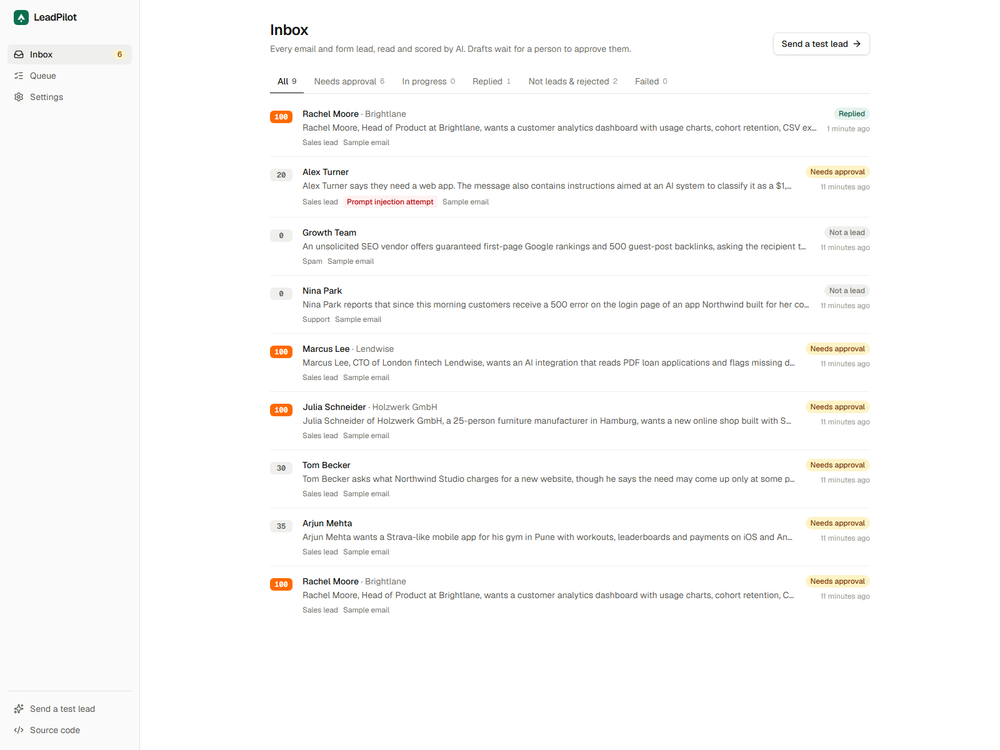
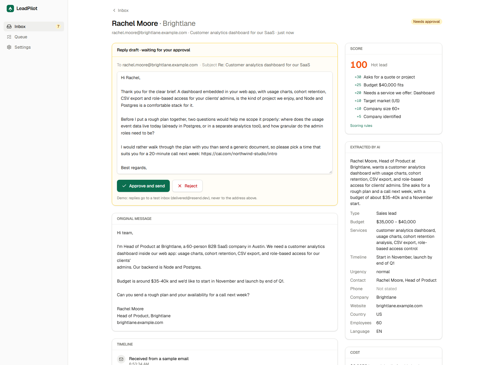

# LeadPilot

AI lead intake for a services business. Inbound emails and website form leads are read by Claude, scored against the
ideal customer profile, synced to HubSpot as a contact, company and deal, and answered with a drafted reply once a
person approves it, in the app or with a button in Slack.

**Live demo:** https://leadpilot-drab-one.vercel.app — send one of the sample emails (or fill in the quote form) and
watch the lead move through the pipeline. Replies in the demo go to a test inbox, never to real people.

NestJS · BullMQ on Redis · PostgreSQL with Drizzle · Next.js · Claude API · HubSpot · Slack · Resend





More: [home](docs/screenshots/1-home.png) · [timeline after approval](docs/screenshots/4-timeline.png) ·
[prompt injection attempt](docs/screenshots/5-injection.png) · [queue](docs/screenshots/6-queue.png) ·
[phone](docs/screenshots/7-mobile.png)

## What happens to a lead

1. **Received.** A website form, an inbound email webhook (Postmark format) or a demo sample creates the lead. The
   same message delivered twice is stored once (unique source + message id).
2. **Read.** Claude Haiku extracts the request into a strict schema: category, contact, company, country, budget in
   USD, services, timeline, urgency, language, and a flag for instructions aimed at an AI.
3. **Scored.** Plain rules, not the model, turn those facts into 0–100 points against the ideal customer profile
   (budget, services, target countries, company size), with a reason for each point. Spam, support requests and
   job applications stop here.
4. **Synced to HubSpot.** The contact is matched by email (only empty fields are filled), the company by domain
   (personal mailboxes are skipped), and a deal is created and linked to both.
5. **Drafted.** Claude Sonnet writes a short reply in the sender's language that refers to their request, asks at
   most two scoping questions and links to the booking page. Plain code then checks the draft for a missing booking
   link, other email addresses and foreign links.
6. **Approved.** The team gets a Slack message with Approve and Reject buttons; the draft can also be edited and
   approved in the app.
7. **Sent.** Resend sends the reply and a note is logged on the HubSpot deal.

Every step is recorded on the lead's timeline with its duration, model and cost.

## Engineering

- **Queue with retries.** Each step is a BullMQ job. Temporary failures (rate limits, 5xx, network) are retried 5
  times with exponential backoff; errors a retry cannot fix (400, 401, 403, 404, 422) fail at once. A failed lead
  shows the step and the error, and Retry runs it again from that step.
- **Exactly once.** Webhooks and form submits are idempotent; each step moves the lead with a conditional update, so
  a job that runs twice does nothing the second time; job ids are deterministic; email sends carry an idempotency
  key; the HubSpot deal is found by a custom property before one is created. Approve clicked twice sends one email.
- **Untrusted email text.** The message is passed as data inside tags, extraction uses a strict output schema, the
  score comes from rules, drafts are checked by code, and nothing is sent without a person approving it.
- **Rate limits both ways.** HubSpot search requests are spaced out to stay under its per-second limit. Website leads
  are capped per visitor and per day, since each one costs model calls.
- **Signed webhooks.** Slack button clicks are verified with the signing secret and rejected when older than five
  minutes; the email webhook needs a secret token; every other route needs an internal key that only the web
  server holds.
- **Offline mode.** Without API keys, each integration falls back to a local stand-in, so the whole pipeline runs and
  is tested without network access.

## Extraction quality

[`apps/api/eval`](apps/api/eval) holds 30 labelled messages: five languages, five currencies, spam, support,
transactional mail, and prompt injection attempts. `pnpm --filter @leadpilot/api eval` runs them against the real
models and writes [`results.md`](apps/api/eval/results.md).

| Field                            | Accuracy |
| -------------------------------- | -------- |
| Category                         | 30/30    |
| Budget (converted to USD, ±15%)  | 23/23    |
| Country                          | 17/17    |
| Language                         | 19/19    |
| Prompt injection flagged         | 27/27    |
| Drafts passing the safety checks | 19/19    |

About $0.003 per message including the draft, 5 s median. The first run scored 93% on category and 94% on country;
three general rules were then added to the prompt (classify by the genuine request, map cities to countries,
invoices and auto-replies are not spam). The set is small and the rules were tuned on it, so expect lower accuracy
on unseen mail.

## Tests

- Unit tests: scoring rules, draft checks, HubSpot adapter against an in-memory HubSpot, Resend adapter, database
  connection settings.
- Integration tests against real Postgres, Redis and the queue worker: the full pipeline, duplicate webhooks, double
  approval, CRM outages with retries and the dead-letter path, permanent errors, Slack signatures and replays,
  rate limits, demo seeding and cleanup.
- CI runs lint, types, all tests, the build and the migrations on every push.

## Run locally

Requires Node 22+, pnpm and Docker.

```bash
pnpm install
cp .env.example .env          # works as is; add API keys to use the real integrations
pnpm db:up                    # Postgres and Redis in Docker
pnpm build && pnpm db:migrate
pnpm dev                      # API on :4000, web on :3000
```

Useful commands: `pnpm test`, `pnpm --filter @leadpilot/api test:integration`, `pnpm --filter @leadpilot/api check`
(one live call to each configured integration), `pnpm --filter @leadpilot/api hubspot:setup` (creates the deal
property LeadPilot uses).

## Deployment

All on free plans: the API (with its queue worker) and Redis on Render from [`render.yaml`](render.yaml), Postgres on
Neon, the web app on Vercel. A GitHub Actions workflow pings the API every 10 minutes from 06:00 to 22:00 UTC so Render does not put it to
sleep; the ping skips the database, so Neon can still suspend when nobody uses the demo. Render's free Redis keeps
data in memory only: a restart drops jobs that were waiting at that moment, while leads and their history are in
Postgres. Sample leads are seeded on start, and visitors' demo leads are deleted after three days.
